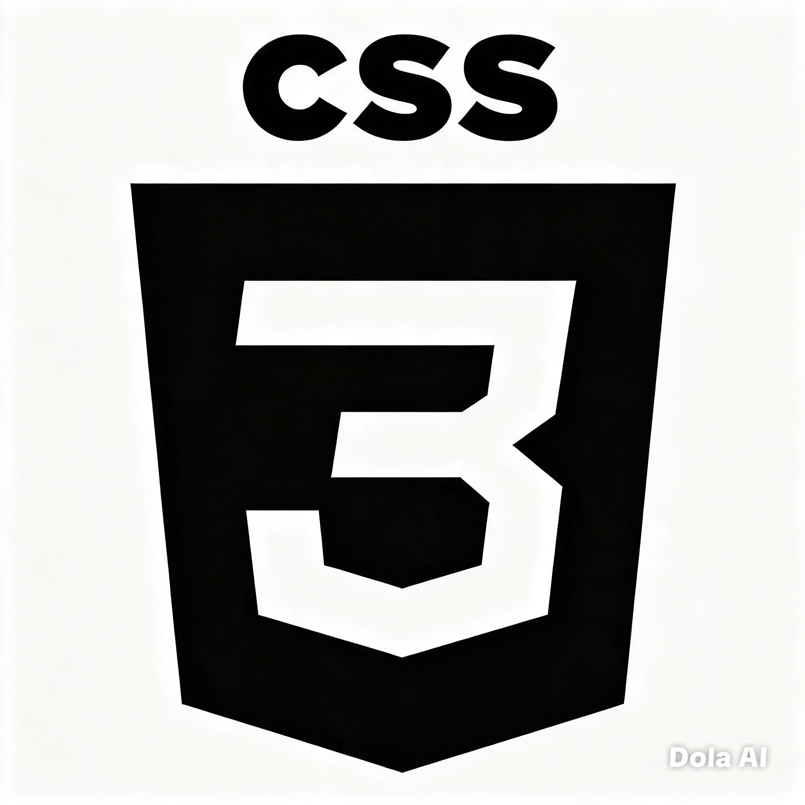
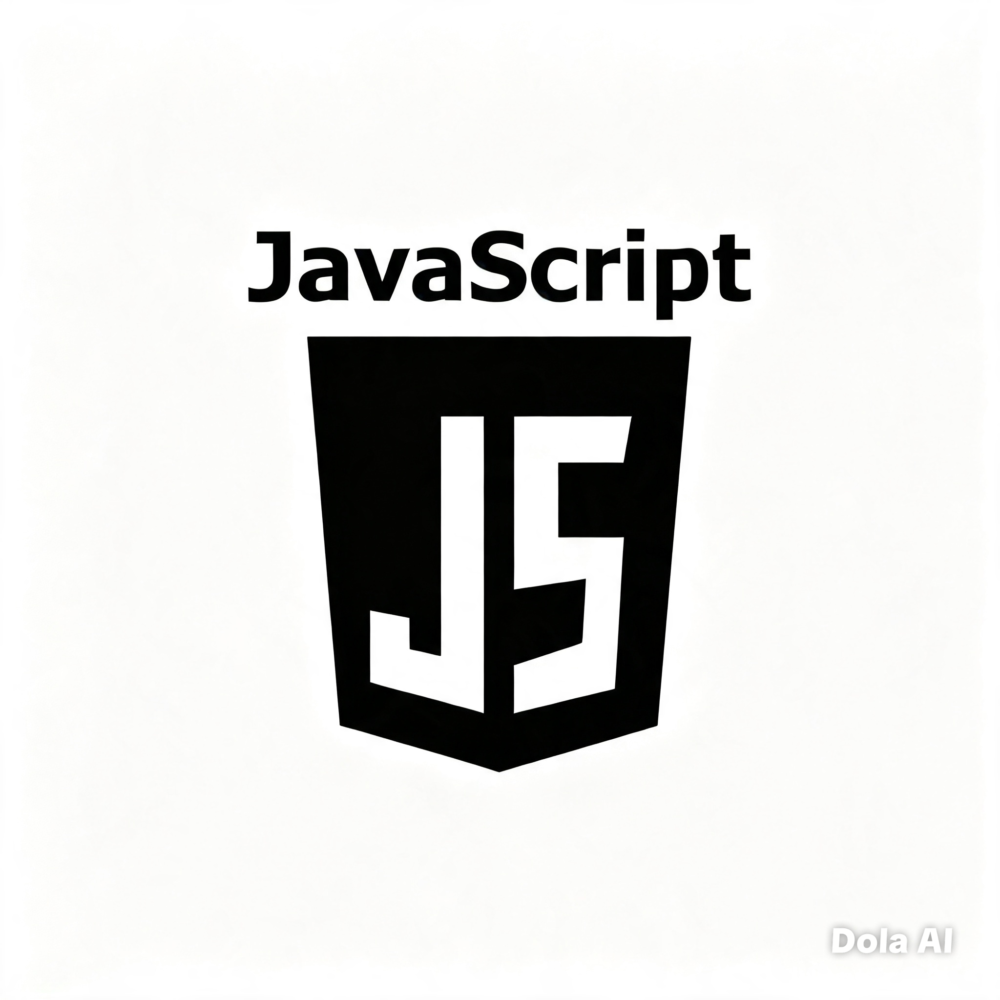

<div align="center">
  
</div>

<br/>

<p align="center">
  <a href="https://www.linkedin.com/in/SEU-LINKEDIN">
    
  </a>
  <a href="https://www.instagram.com/SEU-INSTAGRAM">
    
  </a>
  <a href="https://github.com/SEU-USUARIO-GITHUB?tab=repositories&sort=stargazers">
    
  </a>
  <a href="https://github.com/SEU-USUARIO-GITHUB?tab=followers">
    
  </a>
</p>

<h1 align="center">About Me:</h1>

<hr/>

<h2 align="center">Pessoal:</h2>

```js
const seuNome = {
  role: "Sua fase ou cargo atual",
  field: "Sua área de atuação",
  education: "Seu curso ou formação",
  interests: [
    "Interesse 1",
    "Interesse 2",
    "Interesse 3",
    "Interesse 4"
  ],
  mindset: "Sua mentalidade em uma frase",
  goal: "Seu objetivo"
};
```

<h2 align="center">Tech:</h2>

<p align="center">
  
  
  
  
  
  
</p>

<h2 align="center">Projects:</h2>

<p align="center">Em breve…</p>
